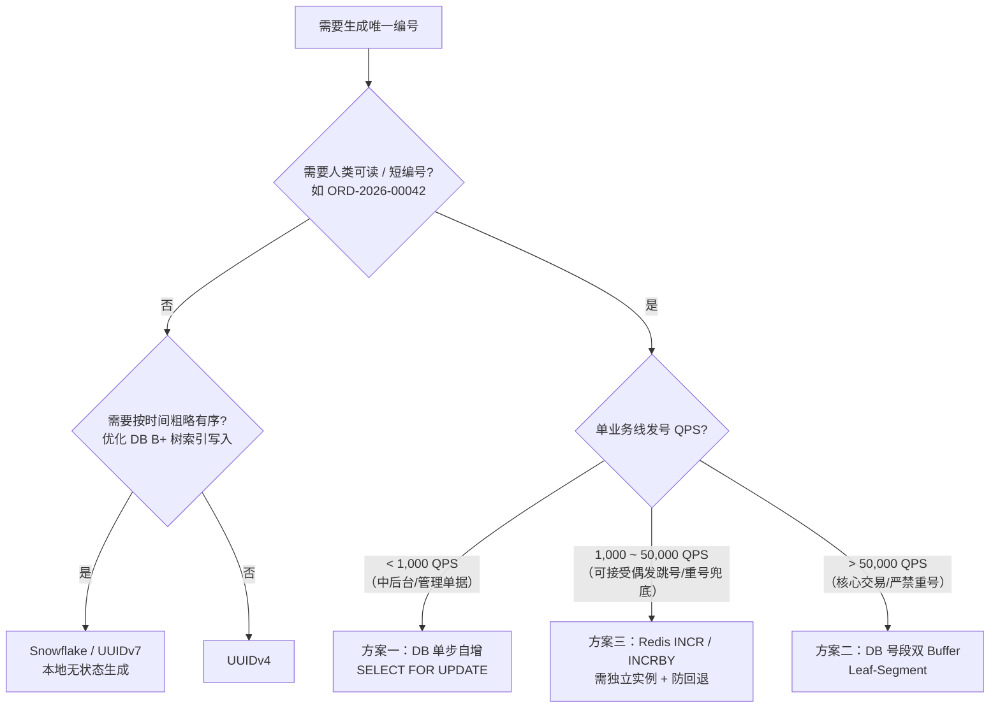
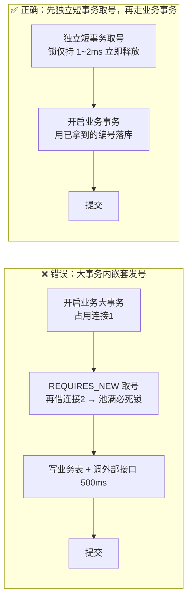
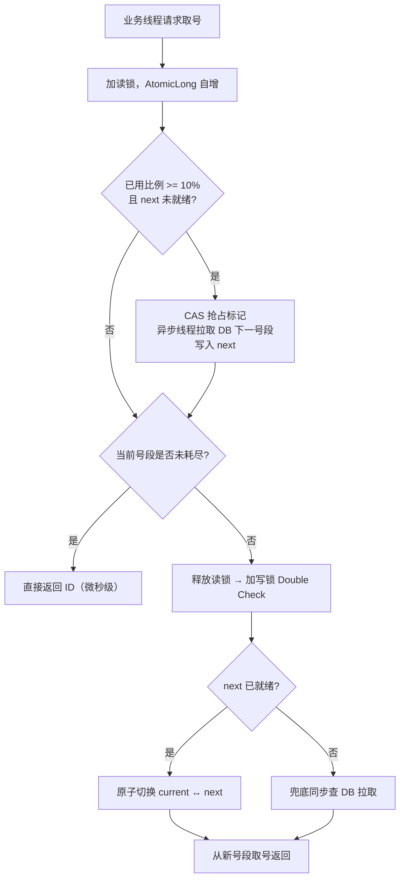

# 分布式发号器原理与实战学习笔记

> 发号器（ID Generator）要解决的核心问题只有一句话：**在多实例并发请求下，高效、不重号、可控递增地吐出唯一编号。**
>
> 现实中不存在“银弹”方案——不同场景对**可读性、连续性、吞吐量、高可用**的权衡完全不同。这篇笔记按从简单到复杂的顺序，把工程里最常用的 3 类自增发号方案（DB 单步、DB 号段双 Buffer、Redis）以及 Snowflake / UUIDv7 的边界一次讲透。

---

## 一、30 秒选型地图



---

## 二、为什么不能直接「查最大值 + 1」？

刚接触发号时最容易写出的反模式：

```sql
-- ❌ 千万不要这样写
SELECT MAX(seq) FROM biz_order WHERE year = 2026;
-- 应用层 +1 后 INSERT
```

**翻车原因（TOCTOU 竞态条件）**：并发下两个请求同时读到 `MAX(seq) = 10`，都算出 `11`，然后同时插入：
- 没建唯一索引 → **直接产生两条重复编号**；
- 建了唯一索引 → 第二个请求撞 `DuplicateKeyException`，高并发下大量请求失败重试，吞吐断崖式下跌。

**结论**：发号必须把**「读旧值 → 加步长 → 写回新值」**做成**不可分割的原子操作**（靠 DB 排他行锁、DB 原子 `UPDATE`、或 Redis 单线程命令）。

---

## 三、方案一：DB 单步自增（`SELECT ... FOR UPDATE`）

> **核心思想**：建一张极小的专用发号表，每个业务维度（如 `order:2026`）只占 **1 行**；取号时对这一行加排他锁，推进 `current_value` 后立即提交释放锁。

### 1. 表结构设计

```sql
CREATE TABLE sys_sequence (
    biz_key       VARCHAR(64) NOT NULL PRIMARY KEY COMMENT '业务隔离键，如 order:2026',
    current_value BIGINT      NOT NULL DEFAULT 0   COMMENT '当前已发出的最大序号',
    updated_at    DATETIME(3) NOT NULL DEFAULT CURRENT_TIMESTAMP(3)
                              ON UPDATE CURRENT_TIMESTAMP(3)
) ENGINE=InnoDB;
```

### 2. 并发排队过程（行锁如何保证不重号）

假设当前 `biz_key = 'order:2026'` 的 `current_value = 10`，请求 A 和请求 B 同时到达：

| 时刻 | 请求 A（事务 T1） | 请求 B（事务 T2） | 数据库该行状态 |
| :--- | :--- | :--- | :--- |
| T1 | `BEGIN` | `BEGIN` | `current_value = 10`，无锁 |
| T2 | `SELECT current_value ... FOR UPDATE` → 拿到行锁，读到 `10` | `SELECT current_value ... FOR UPDATE` → **阻塞等待行锁** | T1 持有 X 锁 |
| T3 | `UPDATE SET current_value = 11` | 继续等待 | T1 持锁，未提交值 `11` |
| T4 | `COMMIT`（返回 `11`，释放行锁） | 立刻唤醒，读到最新已提交值 `11` | T2 持有 X 锁，`current_value = 11` |
| T5 | — | `UPDATE SET current_value = 12` → `COMMIT`（返回 `12`） | 释放锁，`current_value = 12` |

> **关键点**：`SELECT ... FOR UPDATE` 是**当前读**（Current Read），被唤醒后一定看到前一个事务刚提交的最新值，不会受 `REPEATABLE READ` 的 MVCC 快照影响。

### 3. 两个必踩的坑与铁律

#### 坑 1：首次建行并发撞主键（如跨年第一秒 `order:2027` 还不存在）
- 两个请求同时查不到行，同时 `INSERT (biz_key='order:2027', current_value=1)`，其中一个必然抛出 `DuplicateKeyException`。
- **解法**：`INSERT` 时捕获主键冲突异常，**退出当前失败事务后，在外层重新执行一次完整取号**（此时行已存在，走正常 `FOR UPDATE` 即可）。
- ⚠️ **重试铁律**：重试必须放在独立事务**外部**，绝不能在同一个已标 `rollbackOnly` 的事务内 catch 后继续查。

#### 坑 2：把发号塞进大业务事务里 → 拖垮全站 + 连接池死锁
- **拖垮吞吐**：如果外层大事务还要写主表、调 RPC、发消息耗时 500ms，发号行锁就会被死死占住 500ms，全站发号被串行化成 **2 QPS**。
- **连接池死锁**：外层事务占着 1 条连接，发号用 `REQUIRES_NEW` 再去连接池借第 2 条连接。当连接池大小为 `N`，同时进来 `N` 个请求，全占着外层连接等第 2 条连接 → **全员永久卡死直到超时**。



### 4. 标准实现模板（Java + Spring `TransactionTemplate`）

```java
public long nextValue(String bizKey) {
    // 禁止在活跃业务事务内取号：避免拉长行锁持有时间或引发连接池自死锁
    if (TransactionSynchronizationManager.isActualTransactionActive()) {
        throw new IllegalStateException("nextValue must be called outside an active transaction");
    }

    for (int attempt = 0; attempt < 3; attempt++) {
        try {
            return txTemplate.execute(status -> {
                Long current = sequenceDao.selectForUpdate(bizKey);
                if (current == null) {
                    sequenceDao.insertInitial(bizKey, 1L);
                    return 1L;
                }
                long next = current + 1;
                sequenceDao.updateValue(bizKey, next);
                return next;
            });
        } catch (DuplicateKeyException e) {
            // 仅在首条记录并发初始化时触发，跳出失败事务后重试即走正常行锁路径
            if (attempt == 2) {
                throw e;
            }
        }
    }
    throw new IllegalStateException("unreachable");
}
```

### 5. 两个常见业务认知误区
- **跳号不需要也不应该回收**：独立事务取到 `11` 后，下游业务落库失败导致 `11` 空缺——这是**完全正常的**。硬要“回收重发”必须把发号绑回大事务，换来的是锁竞争与并发灾难。
- **按年/按天分键务必统一时区**：建议固定 `UTC`（或明确约定的单一业务时区），切忌依赖容器机器本地时区，否则跨日/跨年边界会在不同机房产生分裂键。

---

## 四、方案二：DB 号段模式（Leaf-Segment 双 Buffer）

> **核心思想**：与其每次发 1 个号都跑一趟数据库，不如**一次从 DB 批发 1000 个号**放进应用内存里用 `AtomicLong` 无锁分发，把 DB 压力直接压低 **1000 倍**。

### 1. 为什么单号段不够，必须「双 Buffer」？

如果内存里只缓存 1 个号段 `[1, 1000]`：
- 前 999 次发号耗时 `< 1 μs`；
- 发到第 1000 个号时，所有并发线程一起被卡住等待 DB 批量更新下一段 `[1001, 2000]` → 出现周期性 **RT 毛刺**；若此时 DB 抖动 2 秒，全站直接不可用。

**双 Buffer（美团 Leaf-Segment）解法**：每个业务键维护 `current` 和 `next` 两个槽位：
1. 当前号段消耗超过 **10%** 时，后台线程池**异步**去 DB 拉取下一号段塞入 `next`；
2. 当前号段耗尽时，内存指针瞬间切换到 `next`，业务线程**零阻塞**；
3. 即使 DB 短暂宕机几分钟，靠内存里预热好的两段号仍可平稳撑过故障窗口。



### 2. 表结构与单次批发 SQL

```sql
CREATE TABLE leaf_alloc (
    biz_tag     VARCHAR(64) NOT NULL PRIMARY KEY,
    max_id      BIGINT      NOT NULL DEFAULT 1 COMMENT '已分配出去的最大上界',
    step        INT         NOT NULL           COMMENT '单次批发号段长度',
    updated_at  DATETIME(3) NOT NULL DEFAULT CURRENT_TIMESTAMP(3)
                            ON UPDATE CURRENT_TIMESTAMP(3)
) ENGINE=InnoDB;

-- 同一个短事务内推进并读取新号段：[max_id - step + 1, max_id]
BEGIN;
UPDATE leaf_alloc SET max_id = max_id + step WHERE biz_tag = 'order';
SELECT max_id, step FROM leaf_alloc WHERE biz_tag = 'order';
COMMIT;
```

### 3. 并发读号核心代码骨架（`ReentrantReadWriteLock` + Double Check）

```java
public long nextId(SegmentBuffer buffer) {
    while (true) {
        buffer.rLock().lock();
        try {
            Segment cur = buffer.getCurrent();
            // 消耗达 10% 且尚未加载下一段时，仅允许一个线程触发异步预加载
            if (!buffer.isNextReady()
                    && (cur.getIdle() < 0.9 * cur.getStep())
                    && buffer.compareAndSetLoading(false, true)) {
                asyncLoadNextSegment(buffer);
            }
            long value = cur.getAndIncrement();
            if (value < cur.getMax()) {
                return value;
            }
        } finally {
            buffer.rLock().unlock();
        }

        // 当前号段耗尽：切写锁做段切换，避免并发重复切换
        waitAndSleepIfLoading(buffer);
        buffer.wLock().lock();
        try {
            Segment cur = buffer.getCurrent();
            long value = cur.getAndIncrement();
            if (value < cur.getMax()) {
                return value;
            }
            if (buffer.isNextReady()) {
                buffer.switchPos();
                buffer.setNextReady(false);
            } else {
                throw new IllegalStateException("Both segments are unavailable");
            }
        } finally {
            buffer.wLock().unlock();
        }
    }
}
```

### 4. 生产落地必须注意的 3 件事
1. **步长 `step` 决定容灾窗口**：通常按 `峰值 QPS × 10~20 分钟` 设定，也可以在运行期根据两次拉取的间隔**动态扩缩 `step`**（拉得太快翻倍、太慢减半）。
2. **多节点与重启必然跳号**：节点 A 拿 `[1, 1000]`、节点 B 拿 `[1001, 2000]`，重启后未用完的号段直接丢弃——**趋势递增，不保证全局严格连续**。
3. **防主从切换撞号**：如果发号库主从用默认异步复制，主库推进到 `2000` 后宕机、从库只同步到 `1000` 并升主，就会重复发放 `[1001, 2000]`。发号专用库务必开启 **MySQL 半同步复制（Semi-Sync）** 或使用强一致存储（如 Raft / Paxos）。

---

## 五、方案三：Redis 发号器（`INCR` / `INCRBY`）

> **核心思想**：利用 Redis 单线程事件循环，天然把「读旧值 → +1 → 写回」做成原子命令，**零锁竞争、单 Key 轻松跑到 5w–10w QPS**，且支持按天/按年自动重置。

### 1. 两种常见用法

- **单步自增（适合中高频、期望尽量连续的可读编号）**：
  ```text
  INCR seq:order:20261127   →  1, 2, 3 ...
  ```
- **号段批发（结合本地缓冲，突破单 Key 网络 RTT 瓶颈）**：
  ```text
  INCRBY seq:order:20261127 1000  →  拿到 [1, 1000]，JVM 内存无锁发号
  ```

### 2. 按日/按年自动清理：必须用 Lua 保证 `INCR + EXPIRE` 原子性

如果按天生成 Key（如 `seq:order:20261127`），不设过期时间会慢慢撑爆内存；但拆成两条命令（先 `INCR` 再 `EXPIRE`）时，若 `INCR` 完应用崩溃，Key 就会变成**永不过期的僵尸 Key**。

**标准写法——一段 Lua 脚本原子执行：**

```lua
-- KEYS[1] = seq:order:20261127, ARGV[1] = 172800 (48小时)
local val = redis.call('INCR', KEYS[1])
if val == 1 then
    redis.call('EXPIRE', KEYS[1], tonumber(ARGV[1]))
end
return val
```

> **TTL 留足余量**：按天重置的 Key 建议设 **48 小时**（而非卡死 24 小时），防止时钟偏差或跨零点边界提前过期归 `1`。

### 3. Redis 发号的 3 个经典生产大坑

| 风险点 | 怎么发生的 | 工程解法 |
| :--- | :--- | :--- |
| **1. 主从切换 / 重启水位回退 → 发重号** | Redis 默认**异步主从复制**，AOF `everysec` 最多丢 1 秒数据；主库发到 `1050` 后宕机，从库只同步到 `1000` 并升主 → 下一个请求拿到 `1001` 撞号 | ① 业务表必须保留**唯一索引兜底**；<br>② 发号实例独立部署并开启 AOF `always`（牺牲部分吞吐），或结合 DB 做水位恢复 |
| **2. 内存满被 LRU 淘汰 → 突然归 `1`** | 如果 Redis 配了 `allkeys-lru`，发号 Key 被当成普通缓存逐出，下次 `INCR` 直接从 `1` 重新开始 | 发号专用实例必须配 **`noeviction`**（禁止淘汰），绝不与普通业务缓存混用 |
| **3. 灾备恢复时并发初始化覆盖** | Redis 清空后，两个线程同时从 DB 查到最大号 `5000`，如果直接 `SET key 5000` 会把刚涨到 `5005` 的水位覆盖回去 | 恢复水位必须用 **`SET key value NX`**（仅 Key 不存在时写入），且跳过安全余量（如 `DB最大值 + 1000`）再 `INCR` |

### 4. 如何突破单 Key 瓶颈？（多实例错峰步长）

单个 Key 在 Redis Cluster 里永远只落到 **1 个分片**，单 Key 极限约 5w–10w QPS。如果还要更高且不想号段丢号，可用 **N 台独立 Redis 实例步长错峰**：

- **Redis-1**：初始 `1`，每次 `INCRBY 3` → 发出 `1, 4, 7, 10 ...`
- **Redis-2**：初始 `2`，每次 `INCRBY 3` → 发出 `2, 5, 8, 11 ...`
- **Redis-3**：初始 `3`，每次 `INCRBY 3` → 发出 `3, 6, 9, 12 ...`

> 吞吐直接 ×3，且单台宕机不影响另外两台发号；缺点是**后续扩容极痛**（实例数 N 写死在步长里），因此真正超大规模更常用 **DB 号段双 Buffer** 或 **Snowflake**。

---

## 六、业界 5 种发号方案横向对比

| 维度 | DB 单步自增<br>(`FOR UPDATE`) | DB 号段双 Buffer<br>(Leaf-Segment) | Redis 发号<br>(`INCR` / `INCRBY`) | Snowflake<br>(雪花算法) | UUIDv7 |
| :--- | :--- | :--- | :--- | :--- | :--- |
| **典型 QPS** | 数百 ~ 2k | 10w+（内存分发） | 5w ~ 10w / Key | 百万级（本地计算） | 百万级（本地计算） |
| **编号形态** | 短整数，人类友好 | 短整数，人类友好 | 短整数，人类友好 | 64 位长整型（19 位数字） | 128 位字符串（36 字符） |
| **有序与连续** | 严格递增、偶发跳号 | 趋势递增、节点间交错 | 严格递增（单步） | 趋势递增（按毫秒） | 趋势递增（按毫秒） |
| **强依赖组件** | MySQL | MySQL（容忍短暂宕机） | 独立 Redis 实例 | WorkerID 分配 + 时钟同步 | **无外部依赖** |
| **核心风险** | 行锁放进大事务导致死锁/慢化 | 主从异步切换撞号；重启丢号 | 主从/AOF 回退重号；LRU 逐出 | **时钟回拨**导致重号 | 存储与二级索引体积较大 |
| **最佳场景** | 中后台单号、工单、合同号 | 电商订单号、流水号 | 秒杀/活动流水、按日短编号 | 分布式主键、日志/消息 ID | 微服务无协调主键 |

---

## 七、上线前的一页速查 Checklist

- [ ] **业务表唯一索引兜底**：不管用哪种发号器，业务表的编号字段必须建 `UNIQUE KEY`，把撞号拦截在最后一道防线。
- [ ] **隔离发号事务**：DB 单步发号必须在业务大事务**之外**独立短事务提交，严禁在事务内套 `REQUIRES_NEW` 触发连接池死锁。
- [ ] **外层重试防首插并发**：发号键首次自动建行时，捕获主键冲突并在失败事务外重试。
- [ ] **接受跳号，不回收编号**：业务回滚造成的空号属于正常现象，不为了“强迫症连续”牺牲并发与稳定性。
- [ ] **统一时区生成分期键**：按天/按年重置的 `biz_key` 明确固定时区（如 `UTC`），不依赖容器默认时区。
- [ ] **存储防回退与防驱逐**：DB 号段库开半同步复制；Redis 发号走独立实例 + `noeviction` + Lua 原子 `INCR/EXPIRE` + `SET NX` 水位恢复。
