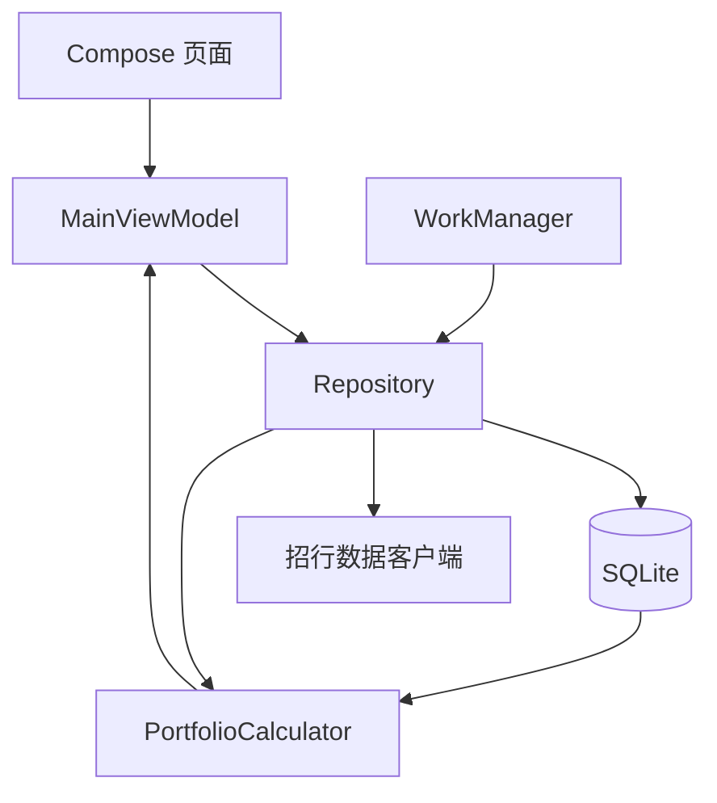

# 从净值到收益：我做了一个招行理财收益 Android App

买了几款银行理财后，我一直缺少一个简单的问题答案：

> 今天赚了多少钱？

银行 App 能看到产品净值，也能看到当前持仓，但当同一个产品分多次买入、发生部分赎回，或者想比较不同产品的日收益时，手工计算很快就会变得麻烦。

于是我做了一个只运行在手机上的 Android App。它不需要后端服务器，录入产品、购买日期和金额后，会自动同步净值并计算收益。

本文记录这个 App 从数据获取、收益计算到本地存储的完整实现，以及开发过程中几个比预期更容易踩坑的地方。

> 本项目用于个人学习和资产记录，不构成投资建议。文中使用的是招商银行网页端公开访问的数据接口，并非官方开放 API，接口可能随时调整。

## 最终实现了什么

目前 App 支持：

- 按产品名称或代码搜索理财产品；
- 同一产品分多次买入，每笔保留独立成本；
- 加仓和按实际到账金额减仓；
- 计算当前市值、累计收益、收益率和最新日收益；
- 展示日万收、七日年化、近一月、三月、半年、一年及成立以来年化；
- 查看最近 14 天的日万收曲线，并缩放、拖动横轴；
- 查看历史日收益，默认每页 14 天；
- 按当日收益、日万收、七日年化和月年化排序；
- 每 6 小时在联网时自动同步一次；
- 使用 SQLite 保存在手机本地，重启和覆盖升级不会丢失。

整个 App 是单机架构，手机直接请求数据源，不需要部署 Java 服务或网页前端。

## 技术选型

我选择的技术栈比较克制：

- Kotlin
- Jetpack Compose + Material 3
- SQLiteOpenHelper
- OkHttp
- WorkManager
- Bouncy Castle
- JUnit

Compose 负责界面，SQLite 保存产品、净值和交易记录，OkHttp 请求数据，WorkManager 负责周期同步。收益计算被放在一个没有 Android 依赖的纯 Kotlin 模块中，便于写单元测试。

整体结构如下：



这样的分层有一个直接好处：界面不关心数据从网络还是本地来，后台任务和前台刷新也复用同一个 Repository。

## 数据从哪里来

招商银行理财网页会请求 `cfweb` 接口获取产品信息和历史净值。请求不是简单的 HTTP POST，还需要携带应用标识、时间戳和签名。

客户端大致做了三件事：

1. 根据关键词搜索产品；
2. 根据产品代码获取产品详情；
3. 按页拉取历史净值。

请求签名使用 SM4 ECB + PKCS7Padding，结果再做 Base64 编码。这里没有把网页中的配置常量写进文章，因为它们属于易变的实现细节；网页改版后，常量和签名规则都可能失效。

数据接口还有两个分支：

- `isSA = 1` 的产品使用 SA 净值接口；
- 其他产品使用普通产品净值接口。

这部分最容易出现“请求成功，但数据不对”的情况。例如，一个看起来支持日期参数的接口实际上会忽略日期范围，必须换用另一个按日期查询的接口。对外部接口不能只看返回码，还要检查返回数据是否真的满足请求条件。

产品查询也做了兜底。网页的关键词搜索是模糊匹配，输入完整产品代码时，精确产品反而可能不在前几条结果里。因此 App 会额外按代码查询一次，并把精确匹配放在列表第一位。

## 为什么仍然需要本地缓存

如果每次打开 App 都下载所有历史净值，会慢，也会浪费流量。SQLite 中保存了三类数据：

| 表 | 内容 |
| --- | --- |
| `products` | 产品名称、公司、风险等级、产品类型和原始详情 |
| `navs` | 日期、单位净值、累计净值、万份收益和七日年化 |
| `holdings` | 产品代码、交易日期、金额和备注 |

`navs` 以“产品代码 + 日期”为主键，重复同步时直接覆盖。因此同步可以采用增量策略：

```kotlin
val start = latestDate?.minusDays(7)
val rows = client.fetchNavs(code, start)
database.upsert(rows)
```

这里故意回看 7 天，而不是只从最后一天之后开始。原因是净值偶尔会被修正后重新发布，回看几天可以覆盖旧值。

彻底删除一个产品时，App 会同时删除它的交易记录、历史净值缓存和产品信息。

## 收益计算：最核心的一层

### 净值型产品

假设买入金额为 \(A\)，买入日或之后第一个有效净值为 \(N_0\)，则持有份额为：

\[
S = \frac{A}{N_0}
\]

最新净值为 \(N_t\) 时：

\[
V_t = S \times N_t
\]

\[
P_t = V_t - A
\]

也就是说，我们并不要求买入当天一定有净值。周末或节假日买入时，会使用之后第一个有效净值。

### 现金管理类产品

现金管理类产品通常给出“万份收益”。如果当天万份收益为 \(W_t\)，前一天余额为 \(B_{t-1}\)，则当天收益为：

\[
I_t = B_{t-1} \times \frac{W_t}{10000}
\]

\[
B_t = B_{t-1} + I_t
\]

代码按天复利计算，买入次日开始产生收益。

### 用统一指标比较两类产品

净值型产品通常没有“万份收益”字段，但可以换算出等价的日万收：

\[
W_t = \left(\frac{N_t}{N_{t-1}} - 1\right) \times 10000
\]

它的含义很直观：如果投入 1 万元，这一天理论上赚了多少钱。

这样，净值型产品和现金管理类产品就可以放在同一张排行榜中比较。

### 多笔买入

同一个产品在不同日期买入，成本净值不同，不能简单把金额相加后使用一个成本。

App 会为每笔交易单独计算份额和收益，再按产品聚合：

```kotlin
val totalValue = lots.sumOf { it.currentValue }
val totalProfit = lots.sumOf { it.profit }
val dailyProfit = lots.sumOf { it.dailyProfit }
```

这也是为什么数据库保留的是“交易记录”，而不是每个产品只有一行持仓。

### 减仓为什么用负现金流

减仓录入的是实际到账金额。内部把买入记为正金额，把减仓记为负金额：

```kotlin
val signedAmount = if (redemption) -amount else amount
val shares = signedAmount / nav
```

负份额会抵消后续的持仓收益，但减仓之前已经产生的收益仍然保留。因此：

\[
净投入 = 所有买入金额 - 所有减仓到账金额
\]

\[
累计收益 = 当前市值 - 净投入
\]

这个模型不需要额外维护“已实现收益”和“未实现收益”两套账，也能自然支持多次加仓和减仓。

保存减仓前，App 会按时间顺序重放交易，检查当时可赎回市值，避免出现减仓金额超过持仓的情况。

## 年化收益怎么计算

对于净值型产品，区间年化公式为：

\[
R = \left(\frac{N_t}{N_0}\right)^{\frac{365}{d}} - 1
\]

其中 \(d\) 是两个净值日期之间的实际天数。

现金管理类产品则先把区间内每日万份收益复合起来，再年化。

App 分别计算：

- 七日年化；
- 近一月年化；
- 近三个月年化；
- 近半年年化；
- 近一年年化；
- 成立以来年化。

如果历史数据不足对应周期，就显示 `-`，而不是用更短区间冒充长期收益。

## 如何合并整组持仓的收益曲线

不同产品并不会在完全相同的日期公布净值。合并总收益曲线时，需要先取得所有日期的并集，再对缺失日期沿用上一笔收益。

伪代码如下：

```kotlin
for (date in allDates) {
    for (series in holdingSeries) {
        if (series.hasValue(date)) {
            lastValue[series] = series.value(date)
        }
    }
    total[date] = lastValue.sum()
}
```

如果直接按数组下标相加，节假日、停牌或不同产品公布频率不一致时，曲线会错位。

## 后台同步并不等于准时执行

App 使用 WorkManager 每 6 小时请求一次同步，并要求设备已联网：

```kotlin
PeriodicWorkRequestBuilder<SyncWorker>(6, TimeUnit.HOURS)
    .setConstraints(networkConnected)
```

需要注意：WorkManager 保证任务最终会执行，但不保证精确到某个时刻。Android 会根据电量、网络和厂商省电策略推迟后台任务。

因此 App 还提供两种补充方式：

- 每次启动时主动刷新；
- 下拉页面或点击按钮手动刷新。

对净值这种低频更新数据，这比追求分钟级定时更合适。

## 图表没有引入第三方库

收益曲线使用 Compose Canvas 绘制，支持：

- 纵轴刻度和横向网格；
- 红涨绿跌；
- 默认显示最新 14 天；
- 双指缩放横轴；
- 左右拖动查看更早数据；
- 一键恢复最近 14 天。

自己绘制的代码量并不大，也避免为了两张折线图引入体积较大的图表依赖。

历史日收益采用分页展示，每页 14 天。相比一次渲染几年数据，分页更容易阅读，也减少了 Compose 列表的渲染压力。

## 开发过程中踩过的坑

### 1. 接口参数不一定真的生效

某个净值接口虽然接受开始日期和结束日期，但服务端会忽略。最终通过对比返回日期范围，才确认需要换接口。

经验是：对第三方接口做验证时，要验证业务结果，而不只是 HTTP 200。

### 2. 产品详情接口会返回“未找到”

部分代销产品能被搜索到，却无法通过详情接口查询。解决办法是退回关键词搜索，再从结果中寻找产品代码完全匹配的项。

### 3. 历史数据一多，算法会悄悄变慢

最初计算每一天的月年化时，都会重新扫描之前的全部历史，复杂度接近 \(O(n^2)\)。保存十年数据后，启动明显变慢。

后来改成只扫描对应时间窗口，七日年化最多看七天，月年化最多看一个月，启动速度恢复正常。

### 4. “未加载”不能显示成“无持仓”

数据库尚未计算完成时，Portfolio 还是 `null`。如果此时把空列表直接传给页面，用户会短暂看到“还没有持仓”，很容易误以为数据丢了。

正确做法是区分三种状态：

- 加载中；
- 已加载但没有数据；
- 已加载且有数据。

### 5. 减仓会破坏很多原有假设

只支持买入时，金额永远为正。加入减仓后，收益率分母、当前市值、删除交易和编辑历史记录都需要重新检查。

特别是删除一笔早期买入后，后面的减仓可能超过可用持仓，因此编辑和删除也必须重新校验整个交易序列。

## 测试策略

收益计算很适合使用纯单元测试。当前覆盖了几个关键场景：

- 同一产品不同日期分两次买入；
- 净值型产品换算日万收；
- 现金管理产品的七日年化单位转换；
- 多周期复合年化；
- 部分减仓后保留已实现收益；
- 减仓后只保留剩余份额的未来收益。

例如，测试中先以净值 1.00 买入 100 元，再在净值 1.01 时到账 50 元，最后把净值更新到 1.02，检查剩余市值、累计收益和最新日收益是否同时正确。

界面则在 Android 模拟器中回归以下流程：

- 搜索并录入产品；
- 加仓、减仓、编辑和删除；
- 强制停止后重新打开，确认数据仍在；
- 排行切换；
- 日期选择；
- 后台任务注册；
- Release 包覆盖安装。

## 数据安全与边界

数据库文件位于 App 私有目录中，普通应用无法直接读取。覆盖安装会保留数据，但卸载 App、恢复出厂设置或手机损坏都会导致本地数据丢失。

后续计划通过坚果云 WebDAV 保存加密备份：

- 只备份交易记录，净值可以重新下载；
- 使用独立密码进行 AES-GCM 加密；
- 坚果云只看到文件名、大小和更新时间；
- 新手机输入备份密码后恢复。

这部分目前仍是设计方案，尚未进入 1.5.0。

## 打包与安装

项目使用 Gradle 构建：

```bash
cd android
./gradlew testDebugUnitTest lintDebug assembleRelease
```

Release 构建开启了 R8 压缩和资源裁剪。当前是个人自用版本，使用调试证书签名，可以直接覆盖升级，但不适合提交应用商店。

如果正式分发，应生成并妥善保管独立的 release keystore。一旦丢失签名密钥，以后的版本就无法覆盖安装。

## 最后的体会

这个 App 的界面并不复杂，真正费时间的部分是“把定义说清楚”：

- 买入日没有净值时用哪一天？
- 日万收对净值型产品意味着什么？
- 多次买入如何保留不同成本？
- 减仓后累计收益是否保留？
- 长周期数据不足时要不要显示年化？

金融计算中，公式本身往往不难，难的是让每一个字段都有稳定、可解释的口径。

把数据获取、本地缓存、收益计算和界面状态分开之后，外部接口即使发生变化，也只需要调整客户端；计算规则变化时，也可以通过单元测试确认没有破坏已有场景。

这也是这次开发最有价值的收获：一个真正可长期使用的小工具，不只是“能显示数字”，而是每个数字都能解释清楚它从哪里来。
